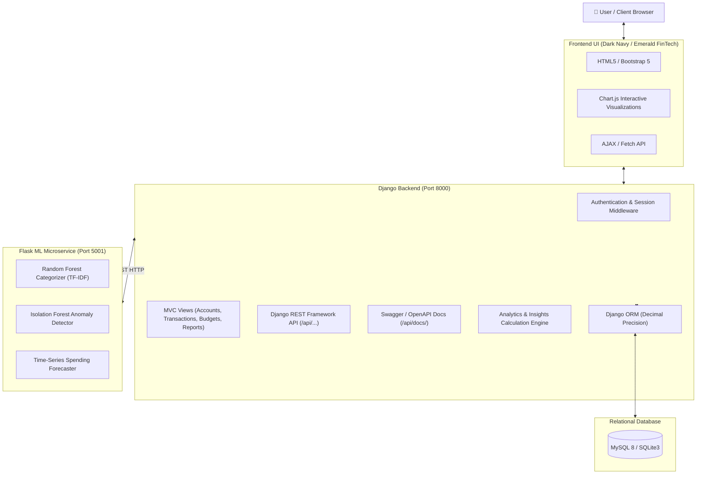
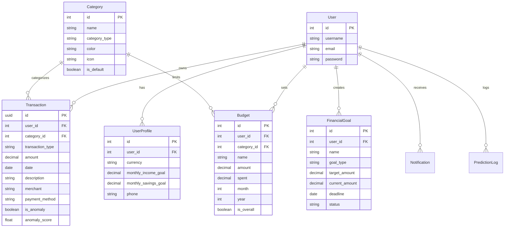

# Finance-Tracker Pro 🚀
### AI-Powered Personal Finance & Spending Analytics Platform

[](https://python.org)
[](https://djangoproject.com)
[](https://flask.palletsprojects.com)
[](https://mysql.com)
[](https://docker.com)
[](https://scikit-learn.org)

**Finance-Tracker Pro** is a full-stack, enterprise-style personal financial management and analytics platform engineered with **Django 4.2**, a separate **Flask ML Microservice**, **MySQL 8** (with SQLite fallback for rapid local dev), and interactive **Chart.js** data visualizations.

---

## 📑 Table of Contents
1. [Key Features](#-key-features)
2. [System Architecture](#-system-architecture)
3. [Relational Database Schema](#-relational-database-schema)
4. [Machine Learning Engine](#-machine-learning-engine)
5. [REST API Documentation](#-rest-api-documentation)
6. [Quick Start & Setup](#-quick-start--setup)
7. [Docker Deployment](#-docker-deployment)
8. [Automated Test Suite](#-automated-test-suite)
9. [Demo Credentials](#-demo-credentials)
10. [Project Structure](#-project-structure)

---

## 🌟 Key Features

### 1. 💼 Financial Transaction Management (Full CRUD)
- **Income Tracking**: Sources, amounts, payment methods, transaction timestamps, notes.
- **Expense Tracking**: Granular categorization, merchants, payment channels (UPI, Cards, Net Banking, Cash).
- **Advanced Filtering & Sorting**: Filter transactions by date range, transaction type, category, or min/max amount.
- **CSV Import/Export**: Bulk-import your bank statements via CSV with format validation; export filtered histories with a single click.
- **Strict Data Isolation**: Multi-tenant design where every user's records are strictly scoped to their account.

### 2. 📊 Advanced Financial Dashboard
- **Real-Time KPIs**: Current Balance, Total Income, Total Expenses, Monthly Savings, Savings Rate (%), and Budget Utilization (%).
- **Interactive Visualizations (Chart.js)**:
  - 6-Month Income vs. Expense Comparison (Grouped Bar Chart).
  - Expense Category Distribution (Interactive Doughnut Chart).
  - 30-Day Daily Spending Trend (Smooth Spline Area Chart).
- **Automated Insights Engine**: Rule-based & ML-driven insights highlighting month-over-month variances, category overspending, and threshold breaches.
- **Budget Alerts**: Visual warnings when spending approaches or exceeds 80% and 100% of budgeted amounts.

### 3. 🤖 Machine Learning Microservice
- **Automated Categorization**: TF-IDF Vectorizer + Random Forest Classifier trained on merchant/description texts (with rule-based fallback).
- **Spending Forecasting**: Time-series forecast predicting the next 3 months of expenses combining Linear Trend Regression and Rolling Moving Averages.
- **Anomaly Detection**: Unsupervised **Isolation Forest** flagging irregular transactions and atypical expense amounts with normalized anomaly scores.

### 4. 🎯 Budget & Goal Tracking
- **Category-Wise & Overall Budgets**: Set spending limits per month/year.
- **Progress Tracking**: Real-time spending calculation directly from transaction records.
- **Savings Goals**: Track milestones (e.g., Emergency Fund, Laptop, Vacation) with target dates and visual completion bars.

### 5. 📄 Financial Reporting & PDF Export
- **Customizable Reports**: Monthly, Annual, or All-Time consolidated financial statements.
- **Direct Downloads**: Instant CSV and formatted PDF reports generated using ReportLab.

---

## 🏛 System Architecture



---

## 🗄 Relational Database Schema



---

## 🧠 Machine Learning Engine

The ML architecture operates as an autonomous microservice communicating over HTTP JSON endpoints:

### A. Expense Categorization
- **Algorithm**: `RandomForestClassifier` with balanced class weights.
- **Preprocessing**: Text lowercasing, alphanumeric sanitization, sublinear TF-IDF bi-gram extraction (`ngram_range=(1,2)`, `max_features=5000`).
- **Feedback Loop**: When users manually recategorize transactions, corrected records are persisted in `prediction_logs` for periodic batch retraining.

### B. Spending Forecasting
- **Approach**: Blended Hybrid Model (60% Linear Regression Trend + 40% 3-Month Moving Average).
- **Horizon**: Next 30 days and 3 months ahead.
- **Safety**: Clamped to non-negative spending with R² goodness-of-fit tracking.

### C. Anomaly Detection
- **Algorithm**: `IsolationForest` (contamination=0.05, n_estimators=100).
- **Features**: Normalized transaction amount, Log1p-scaled amounts, Z-scores, Day of Week, and Day of Month.
- **Output**: Anomaly score indicator identifying abnormal spending spikes.

---

## 🔌 REST API Documentation

The platform includes comprehensive RESTful APIs built with Django REST Framework and documented via Swagger/OpenAPI.

Access Swagger UI: `http://localhost:8000/api/docs/`  
Access ReDoc UI: `http://localhost:8000/api/redoc/`

### Core Endpoints

| Method | Endpoint | Description | Auth Required |
|---|---|---|---|
| `POST` | `/api/auth/register/` | Register new account and receive Auth Token | No |
| `POST` | `/api/auth/login/` | Sign in with username/password | No |
| `POST` | `/api/auth/logout/` | Revoke current token | Yes |
| `GET` | `/api/transactions/` | List user transactions (supports filtering & pagination) | Yes |
| `POST` | `/api/transactions/` | Create a new transaction | Yes |
| `GET` | `/api/transactions/{id}/`| Retrieve transaction details | Yes |
| `PUT` | `/api/transactions/{id}/`| Update an existing transaction | Yes |
| `DELETE`| `/api/transactions/{id}/`| Delete transaction | Yes |
| `GET` | `/api/budgets/` | List user budgets and real-time utilization | Yes |
| `POST` | `/api/budgets/` | Create a monthly budget limit | Yes |
| `GET` | `/api/analytics/dashboard/`| Aggregated metrics, savings rate, and insights | Yes |
| `GET` | `/api/analytics/monthly/`| Monthly aggregate breakdown | Yes |
| `POST` | `/ml/predict-category` | Microservice: Predict category from description | Direct |
| `POST` | `/ml/detect-anomalies` | Microservice: Run Isolation Forest on expense array | Direct |
| `POST` | `/ml/forecast` | Microservice: Generate 3-month spending forecast | Direct |

---

## ⚡ Quick Start & Setup

### Prerequisites
- Python 3.11+
- Git

### 1. Clone & Enter Project
```bash
git clone https://github.com/your-username/finance-tracker-pro.git
cd "finance-tracker-pro"
```

### 2. Set Up Environment Variables
```bash
cp .env.example .env
```

### 3. Run with One Command (Windows PowerShell)
```powershell
.\scripts\run_local.ps1
```
*(Or on Linux/macOS: `chmod +x scripts/run_local.sh && ./scripts/run_local.sh`)*

### Manual Step-by-Step Execution
If you prefer running the components manually in separate terminals:

**Terminal 1 — ML Microservice:**
```bash
cd ml_service
python -m pip install -r requirements.txt
python train_models.py
python app.py
```

**Terminal 2 — Django Application:**
```bash
cd backend
python -m pip install -r requirements.txt
python manage.py migrate
python manage.py seed_demo_data
python manage.py runserver 0.0.0.0:8000
```

Navigate to: `http://localhost:8000/`

---

## 🐳 Docker Deployment

To launch the complete multi-tier stack (Django, Flask ML Service, MySQL 8, Persistent Volumes, and Static Assets):

```bash
docker compose up --build -d
```

Check running services:
```bash
docker compose ps
```

Stop containers:
```bash
docker compose down
```

---

## 🧪 Automated Test Suite

The platform includes a 58-test automated suite covering authentication, session handling, CRUD, data isolation, budgets, calculations, CSV processing, and REST APIs.

Run tests:
```bash
cd backend
python manage.py test tests --verbosity=2
```

**Result:**
```
Ran 58 tests in 58.160s
OK
```

---

## 🔑 Demo Credentials

A synthetic demo dataset containing 6 months of transactions, realistic spending patterns, and pre-configured budgets is readily seeded:

| Parameter | Value |
|---|---|
| **URL** | `http://localhost:8000/accounts/login/` |
| **Username** | `demo_user` |
| **Password** | `Demo@123456` |

> ⚠️ **Note**: All records generated under `demo_user` are completely synthetic and generated for demonstration and evaluation purposes.

---

## 📂 Project Structure

```
finance-tracker-pro/
├── backend/
│   ├── accounts/              # User profiles, auth views, notifications
│   ├── analytics/             # Dashboard calculations, insights, ML views
│   ├── api/                   # Django REST Framework serializers & viewsets
│   ├── budgets/               # Budget tracking and financial goals
│   ├── config/                # Django project settings, WSGI, URLs
│   ├── reports/               # Monthly/Annual statements, PDF & CSV export
│   ├── static/                # CSS, JavaScript, icons
│   ├── templates/             # Jinja/Django templates (dark theme UI)
│   ├── transactions/          # Transaction CRUD, filters, CSV handlers
│   ├── manage.py
│   ├── requirements.txt
│   └── Dockerfile
├── ml_service/
│   ├── models/                # Serialized joblib models
│   ├── app.py                 # Flask prediction microservice
│   ├── train_models.py        # Model training & metrics evaluation
│   ├── requirements.txt
│   └── Dockerfile
├── dataset/                   # Synthetic dataset exports
├── scripts/
│   ├── run_local.ps1          # Windows local launcher
│   └── run_local.sh           # Unix local launcher
├── tests/
│   └── test_finance_tracker.py# Automated test suite (58 tests)
├── docker-compose.yml         # Full multi-container configuration
├── .env.example               # Template environment configuration
├── .gitignore
└── README.md
```

---

## 📜 License & Acknowledgments
Built with ❤️ for Data Science, Machine Learning, and Python Backend Engineering portfolios. Licensed under the MIT License.
